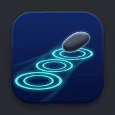
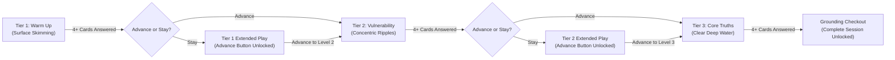

<div align="center">
    
    <h1>Skipstone</h1>
    <p><strong>Start on the surface. Settle in the deep.</strong></p>
    <p><em>A 100% free, privacy-first, offline-first relational intimacy app modeled on skipping stones across water.</em></p>
    <p>
        <a href="https://github.com/tjmustard/Skipstone/blob/main/LICENSE"></a>
        
        
        
    </p>
</div>

---

## 📖 Table of Contents

- [🤔 What is Skipstone?](#-what-is-skipstone)
- [✨ Core Differentiation](#-core-differentiation)
- [🎮 How to Play Immediately](#-how-to-play-immediately)
- [🌊 The Three Depth Tiers](#-the-three-depth-tiers)
- [🗂️ The 8 Included Decks (415 Prompts)](#️-the-8-included-decks-415-prompts)
- [🛡️ Privacy & Zero-Cloud Architecture](#️-privacy--zero-cloud-architecture)
- [🛠️ Developer Setup & Testing](#️-developer-setup--testing)
- [📄 Citation & License](#-citation--license)

---

## 🤔 What is Skipstone?

**Skipstone** is a free, open-source alternative to commercial conversation card games (*We're Not Really Strangers*, *How Deep Will You Go?*, *Skin Deep*). 

The app takes its name from the ritual of skipping stones across calm water:
1. **Level 1 (Warm Up):** Skips lightly across the surface with playful, low-stakes observation and sensory anchors.
2. **Level 2 (Vulnerability):** Slows into concentric ripples, exploring blind spots, formative memories, and relational habits.
3. **Level 3 (Core Truths):** Settles into the clear deep water, opening space for existential reflections, sacred yearnings, and mutual repair.

Skipstone turns a single phone into a physical **talking piece** passed hand-to-hand, replacing fragmented screen time with eye contact, shared silence, and genuine presence.

---

## ✨ Core Differentiation

- **Zero Monetization & Zero Dark Patterns:** No paywalls, subscription tiers, locked expansion decks, daily streaks, ads, or behavioral engagement loops.
- **Dual-Zone Split Layout:** The top half displays the speaker prompt to read aloud; the bottom half provides real-time **Active Listener Attunement** guidance based on psychological research (validating and holding space without offering unsolicited advice).
- **Single-Device Pass-and-Play:** No Bluetooth discovery, Wi-Fi pairing, user accounts, or player profile typing. The physical device is passed between participants (`"pass to your partner"` or `"pass to your left"`).
- **Bilateral Turn Alternation & Role Attribution:** Parent-child decks feature structured bilateral turn-taking with explicit speaker role badges, starter role selection pills in the briefing view, and developmentally attuned prompt routing between parent and child.
- **Dedicated Skip & 1-Step Undo Controls:** Participants can skip uncomfortable prompts without forfeiting their turn (`[Skip Card ↷]`), recycling cards to the back of the active pool, with a stateful 1-step undo ledger guarding against accidental taps.
- **Autonomous Pacing & Felt Safety:** Higher depth tiers are gated behind baseline exposure thresholds, and advancement is non-coercive. When groups choose to stay in a level, a persistent progression action button unlocks directly in the game view, enabling players to advance or conclude the session on their own terms. Every participant holds an unconditional right to pass.
- **Embedded Web Audio Synthesizer:** Pure parametric sine waves and harmonic sweeps (440 Hz–880 Hz) generated directly in the browser via the native Web Audio API with zero external audio asset downloads.
- **De-escalation Checkout:** Every session concludes with a structured 2-step cooldown (one-word emotional state naming + mutual listener appreciation) followed by a screen reminding players to put the phone away.

---

## 🎮 How to Play Immediately

### Option A: Direct Browser Play (Zero Installation)
Simply double-click or open [`index.html`](./index.html) in any web browser on your phone, tablet, or laptop.

If hosted on GitHub Pages:
```
https://tjmustard.github.io/Skipstone/
```

### Option B: Install as an Offline PWA (Mobile)
1. Open [`index.html`](./index.html) in your mobile browser (**Safari** on iOS, **Chrome** on Android).
2. Tap the browser menu / share button:
   - **iOS:** Tap **Share** $\rightarrow$ **Add to Home Screen**.
   - **Android:** Tap **Settings (⋮)** $\rightarrow$ **Install app** or **Add to Home screen**.
3. Launch **Skipstone** directly from your home screen for a full-screen, offline native app experience.

---

## 🌊 The Three Depth Tiers



- **Tier 1 (Surface / Warm Up):** Low-stakes perceptions, nostalgic grounding, sensory preferences, and laughter.
- **Tier 2 (Ripples / Vulnerability):** Formative lessons, unmet needs, childhood patterns, and non-defensive candor.
- **Tier 3 (Deep Water / Core Truths):** Mortality, unspoken burdens, forgiveness, sacred vows, and deep emotional repair.
- **Dedicated Skip & 1-Step Undo:** Skipping a card (`[Skip Card ↷]`) moves it to the back of the active role's pool without advancing tier counts or switching speakers. Accidental taps can be reverted immediately via `[↩ Prev]`.
- **Persistent Progression & Session Completion:** Choosing to stay in Tier 1 or 2 unlocks a persistent bottom action button (`Advance to Level [N+1] →`) so groups can progress whenever ready. In Tier 3, answering 4+ cards unlocks `Complete Session →` directly into the 2-step grounding checkout.
- **Wildcard Bernoulli Randomization ($P \approx 0.12$):** Each draw triggers an independent probability trial pulling from tier-specific somatic and circle challenges (silent eye contact, the hot seat, or collective silence).

---

## 🗂️ The 8 Included Decks (415 Prompts)

All 415 structured prompts and listener attunement prompts are statically bundled into the client application:

| # | Deck Name | Target Audience | Scope | Turn Mechanism |
|---|---|---|---|---|
| 1 | **General Edition** | Friends, dinner parties, community circles, & strangers | 100 Cards | Pass to Left ($N \ge 2$) |
| 2 | **Dating & Early Courtship** | First dates, early romance, & new connections | 45 Cards | Pass to Partner (Dyadic) |
| 3 | **Lovers & Committed Partners** | Long-term couples, life partners, & marriages | 45 Cards | Pass to Partner (Dyadic) |
| 4 | **Family Circles** | Intergenerational family gatherings ($N \ge 3$) | 45 Cards | Pass to Left ($N \ge 3$) |
| 5 | **Parent & Child: Ages 5–8** | Early childhood & primary caregivers | 45 Cards | Bilateral Dyadic (Parent ⮂ Child) |
| 6 | **Parent & Child: Ages 9–12** | Pre-teens / middle childhood & caregivers | 45 Cards | Bilateral Dyadic (Parent ⮂ Child) |
| 7 | **Parent & Child: Ages 13–17** | Adolescents & caregivers | 45 Cards | Bilateral Dyadic (Parent ⮂ Teen) |
| 8 | **Parent & Child: Adult Offspring** | Adult children & aging parents | 45 Cards | Bilateral Dyadic (Parent ⮂ Offspring) |

---

## 🛡️ Privacy & Zero-Cloud Architecture

Skipstone is engineered around the principle of the **Offline Sanctuary**:
- **0 Bytes Transmitted:** No telemetry, analytics, error logging, or remote calls. All data, audio synthesis, and logic reside locally in the client bundle.
- **Local Talking Piece:** Co-located physical turn-taking preserves vocal nuance, somatic cues, and eye contact that networked multiplayer games destroy.
- **Confidentiality by Design:** No user history or answers are recorded. What is spoken stays in the room. Ephemeral session state uses a 15-minute TTL in browser `sessionStorage` and is wiped upon session completion.
- **Custom Deck Privacy:** Imported custom JSON decks are validated locally (<2KB validator) and stored in client-side IndexedDB without cloud synchronisation.

---

## 🛠️ Developer Setup & Testing

### Web Application (Vite + TypeScript + Vitest)

Skipstone uses Node.js with Vite and Vitest for client development, bundling, and testing:

```bash
# 1. Install dependencies
npm install

# 2. Run local development server
npm run dev

# 3. Run automated deterministic test suite
npm test

# 4. Typecheck, build production bundle, and verify size budget (<= 180KB gzipped)
npm run build
```

### Toolchain & Linters (Python + uv)

The HACF developer toolchain and specification scripts use Python managed by [`uv`](https://docs.astral.sh/uv/):

```bash
# 1. Install toolchain dependencies
uv sync

# 2. Run code style & linting checks
uv run ruff check .
uv run ruff format --check .
```

### Directory Structure
```
.
├── index.html                  # Root PWA shell mount point
├── package.json                # Web app dependencies and npm scripts
├── pyproject.toml              # Python toolchain metadata & ruff config
├── public/                     # Static PWA assets, manifest, and service worker
├── src/                        # Modular TypeScript application source
│   ├── core/                   # State machine, PRNG dealer, Web Audio, gestures, storage
│   ├── data/                   # Catalog registry, JSON decks, schema validator
│   └── ui/                     # Modular views, split card layout, modals, components
├── scripts/                    # Bundle size checker & catalog compiler
├── tests/                      # Deterministic Vitest test suite
├── SI/                         # Original authoring source & catalog tables
├── spec/                       # Ground truth specifications & architecture hypergraph
└── .agents/                    # Toolchain and agent automation workflows
```

---

## 📄 Citation & License

If you reference Skipstone in interpersonal research, academic work, or software projects, please cite:

```bibtex
@software{Mustard_Skipstone_2026,
  author = {Mustard, Thomas J. L.},
  title = {{Skipstone: Offline-First Relational Intimacy Application}},
  year = {2026},
  url = {https://github.com/tjmustard/Skipstone}
}
```

Distributed under the **MIT License**. See [`LICENSE`](./LICENSE) for details.
